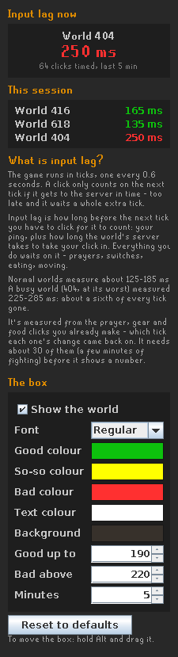

# World Lag

Why does this world feel bad? World Lag shows one number for it: your **input lag**, meaning how long before the next game tick a click has to reach the server to count on that tick.

## What input lag is

The game runs in ticks, one every 0.6 seconds. A click only counts on the next tick if it gets to the server in time. If it's too late, it waits a whole extra tick.

Input lag is how long before the next tick you have to click for it to count. It is your ping plus how long the world's server takes to take your click in. Everything you do depends on it: prayers, switches, eating and moving.

On recorded raids, normal worlds measured about 125–185 ms. A busy world (404, at its worst) measured 225–285 ms, which is about a sixth of every tick gone.

## How it's measured

World Lag uses clicks you already make that the server answers:

- turning a prayer on or off
- wearing or wielding gear
- eating or drinking

For each click it notes how far into the tick you clicked and which tick the change came back on. Over a few minutes this shows the point in the tick where clicks stop making the next tick. That point is your input lag.

It needs about 30 timed clicks (a few minutes of fighting) and a few late ones before it shows a number. Until then the box says "measuring". It starts again on a new world.

World Lag only reads and displays. It never clicks, types, sends anything or changes anything in the game, and it doesn't connect to any outside server.

## The box and the panel

- **The box**: the world and its input lag, coloured green, yellow or red. Hold Alt and drag to move it.
- **The side panel** (stopwatch icon): input lag now, every world you've measured this session, and the box's settings.

## Settings

| Setting | Default | What it does |
|---|---|---|
| Show the world | On | A "World 404" line above the input lag. Off: one line |
| Font | Regular | Regular, Bold or Small |
| Good / So-so / Bad colour | Green / yellow / red | The number's colour |
| Text, Background | White / standard | The box's text and background |
| Good up to | 190 ms | Input lag up to this is green |
| Bad above | 220 ms | Input lag above this is red |
| Measure over | 5 min | How many minutes of play the number covers. Shorter reacts faster, longer is steadier |

The same settings are in the panel and under the plugin's wrench.
